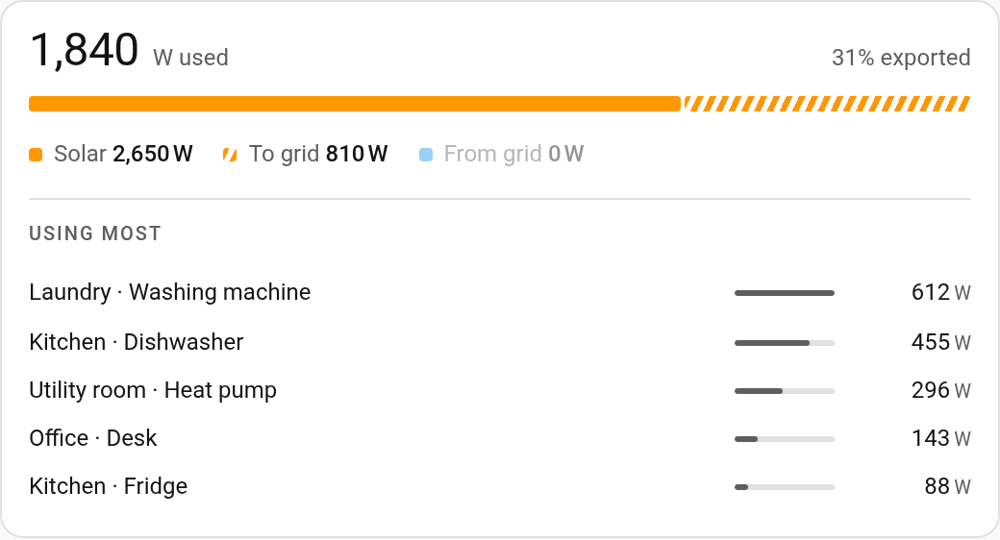
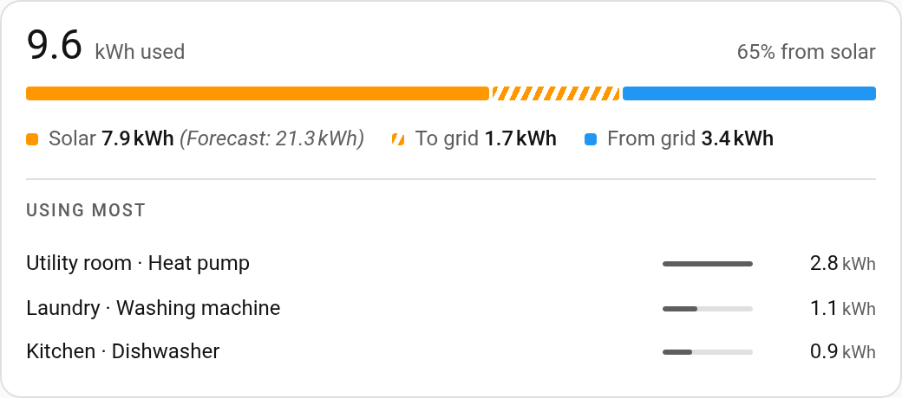
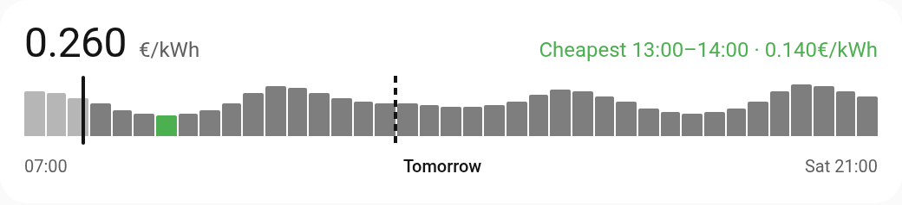

# Home Utility Card

[](https://hacs.xyz/docs/faq/custom_repositories/)
[](LICENSE)

Where the house's electricity comes from, what is using it, and what it costs
over the next day and a half.

<picture>
  <source media="(prefers-color-scheme: dark)" srcset="images/utility-power-dark.png">
  
</picture>

The card has two blocks, and draws whichever ones you configure:

- **flow**: solar kept, solar sold and grid bought as one bar, the figures
  under it, and the biggest consumers under that;
- **price**: a dynamic tariff over a rolling window, with the cheapest hour
  marked.

Live power and today's energy are the same question at two timescales (how
much of what we use is our own), so they are the same block: add the card
twice with different sensors.

There are no headings in the card. Use Home Assistant's heading card between
them.

## Installation

### HACS

1. In HACS, open the menu (⋮) → **Custom repositories**.
2. Add `https://github.com/Sandolution/ha-utility-card` with the type **Dashboard**.
3. Install **Home Utility Card**. HACS adds the dashboard resource for you.
4. Reload the browser.

### Manual

1. Download `home-utility-card.js` from this repository into `config/www/`.
2. Add it as a resource: **Settings → Dashboards → ⋮ → Resources**, URL
   `/local/home-utility-card.js`, type **JavaScript module**.
3. Reload the browser.

## Configuration

Every option can be left out. A configuration only needs the lines where it
differs from the defaults below, and at least one entity.

### Live power

```yaml
type: custom:home-utility-card
household: sensor.house_power
solar: sensor.solar_power
grid: sensor.grid_power
suffix: _power
devices: 5
decimals: 0
```

### Today's energy

```yaml
type: custom:home-utility-card
household: sensor.house_energy_daily
solar: sensor.solar_energy_daily
grid_import: sensor.grid_import_energy_daily
grid_export: sensor.grid_export_energy_daily
solar_forecast: sensor.solar_forecast_today
solar_remaining: sensor.solar_forecast_remaining
suffix: _energy_daily
devices: 3
```

<picture>
  <source media="(prefers-color-scheme: dark)" srcset="images/utility-energy-dark.png">
  
</picture>

### Price

```yaml
type: custom:home-utility-card
price:
  entity: sensor.electricity_price
```

<picture>
  <source media="(prefers-color-scheme: dark)" srcset="images/utility-price-dark.png">
  
</picture>

## Options

`type: custom:home-utility-card` is required. Of the rest, at least one of the
flow entities or `price.entity` has to be there, or the card reports a
configuration error: a card with nothing to show is a mistake, not an empty
card.

### Flow

The flow block is drawn when any of these entities is configured.

| Option | Values | Default | What it does |
|---|---|---|---|
| `household` | a sensor entity | none | What the house is using in total. The big figure at the top. |
| `solar` | a sensor entity | none | What the panels are producing. |
| `grid` | a sensor entity | none | The grid in one sensor: positive is drawing from the grid, negative is feeding it. Only used when `grid_import` and `grid_export` are both missing or unavailable. |
| `grid_import` | a sensor entity | none | What is drawn from the grid, for meters that publish the two directions separately. |
| `grid_export` | a sensor entity | none | What is fed into the grid. |
| `solar_forecast` | a sensor entity | none | Expected production for the whole day, shown beside the solar figure. |
| `solar_remaining` | a sensor entity | none | How much of the forecast is still to come. Shown when you hover the solar figure. |
| `unit` | text | the entities' own unit | The unit to show when the entities don't report one. It doesn't override a unit they do report. |
| `decimals` | a whole number | `1` | Decimals on the flow figures and in the device list. `0` or less shows whole numbers, grouped from 10 000 up (`10 240 W`). |

Solar kept in the house is production minus what went back out, which is how
Home Assistant's Energy dashboard works it out too, so the two agree. All flow
entities should use the same unit: the card doesn't convert between W and kW.

### Device list

The biggest consumers, ranked, under the flow figures.

| Option | Values | Default | What it does |
|---|---|---|---|
| `devices` | a whole number, `0` or more | `0` | How many devices to list. `0` hides the list. |
| `suffix` | text | none | The ending of the per-device entity ids to rank, such as `_power` or `_energy_daily`. Required when `devices` is more than 0. |
| `domain` | a domain | `sensor` | The domain the per-device entities are in. |
| `exclude` | a list of entity ids or names | `[]` | Devices to leave out. A name matches whole leading parts of the entity id: `kitchen` leaves out `sensor.kitchen_*` but not `sensor.kitchenette_*`. |
| `floor` | a number | `0` | Values at or below this count as idle and aren't listed. |
| `strip` | a regular expression, or `""` | see below | Taken off the end of each device's name, ignoring case. `""` keeps the names as they are. |
| `separator` | text, or `""` | `" · "` | Replaces the `\|` and `/` between the parts of a device's name. `""` leaves them as they are. |
| `collapsible` | `true` or `false` | `false` | Adds a button to fold the list away. Folded, the card is as tall as it would be without a device list. |
| `collapsed` | `true` or `false` | `true` | Whether a collapsible list starts folded. Only read when the card is first drawn. |

The flow entities themselves are left out of the ranking automatically; they
are the house as a whole, not one of its devices.

The default `strip` is `\s*[|/-]\s*(power|energy(\s*[|/-]\s*daily)?)\s*$`. It
is made for names like `Kitchen | Dishwasher | Power`, which then read
`Kitchen · Dishwasher`. Set it to fit how your entities are named.

### Price

The price block is drawn when `price.entity` is set. All of these go under
`price:`.

| Option | Values | Default | What it does |
|---|---|---|---|
| `entity` | a sensor entity | none | The price you pay now, all in. The big figure in the block. |
| `curve` | `true` or `false` | `true` | Whether to draw the price curve under it. |
| `curve_entity` | a sensor entity | `price.entity` | The entity the curve's prices are read from. |
| `curve_attribute` | an attribute name | found by itself | The attribute that holds the list of prices. Leave it out and the card looks through the entity's attributes itself (see below). |
| `curve_multiply` | a number, or an entity holding one | `1` | Every point of the curve is multiplied by this first. |
| `curve_add` | a list of numbers and/or entities | `[]` | Added to every point after multiplying. Entities count with their current state. |
| `window_back` | a number of hours | `3` | How much of the past the curve shows. |
| `window_ahead` | a number of hours | `36` | How far ahead the curve shows, as far as the entity has prices. `0` counts as 24. |
| `decimals` | a whole number, `0` to `100` | `3` | Decimals in the price block. |
| `unit` | text | the entity's own unit | The unit to show when the entity doesn't report one. |

Without `curve_attribute`, the card looks at `prices`, `tomorrow_prices`,
`upcoming_prices`, `prices_today`, `prices_tomorrow`, `all_prices`,
`raw_today`, `today` and `data`, then at every other attribute. It takes each
list of points that has a time (`from`, `from_time`, `date_from`, `time`,
`start`, `datetime` or `till`) and a price (`price`, `total`, `value`,
`market_price`, `all_in` or `amount`). Lists for today and tomorrow are merged,
and a point that appears twice counts once.

`curve_multiply` and `curve_add` are there because the curve entity often only
publishes the market price, while the headline entity publishes what you
actually pay. The base is multiplied first, then the fixed parts are added. A
percentage, like VAT, has to be the multiplier; added as a fixed amount it
would flatten the curve instead of scaling it.

```yaml
price:
  entity: sensor.electricity_price_all_in
  curve_entity: sensor.electricity_market_price
  curve_multiply: 1.21        # VAT
  curve_add:
    - sensor.electricity_energy_tax
    - 0.0175                  # supplier margin
```

The window rolls instead of resetting at midnight. By the evening most of
today has passed, and that is when tomorrow's prices are the interesting part.

## text

Every string the card draws, so it can be translated or reworded. A mapping
under `text:`; give only the words you want to change. Each value is text. An
unknown key is a configuration error rather than being ignored.

| Key | Default | Where it shows |
|---|---|---|
| `solar` | `Solar` | label of the solar figure |
| `remaining` | `still expected today` | after the remaining forecast, when hovering the solar figure |
| `from_grid` | `From grid` | label of the grid import figure |
| `to_grid` | `To grid` | label of the grid export figure |
| `headline` | `used` | after the big household figure |
| `from_solar` | `from solar` | after the percentage, when you're drawing from the grid |
| `exported` | `exported` | after the percentage, when you're feeding the grid |
| `devices` | `Using most` | heading of the device list |
| `show_devices` | `Show what is using most` | label of the fold button when folded |
| `hide_devices` | `Hide what is using most` | label of the fold button when open |
| `forecast` | `Forecast:` | before the solar forecast |
| `cheapest` | `Cheapest` | before the cheapest hour in the price block |
| `today` | `Today` | day label on the price curve |
| `tomorrow` | `Tomorrow` | day label on the price curve |
| `no_data` | `No readings available` | when none of the flow entities has a value |
| `no_price` | `Price sensor unavailable` | when `price.entity` has no value |
| `no_forecast` | `No price forecast available` | when no curve could be found |

```yaml
text:
  solar: Zon
  from_grid: Van het net
  to_grid: Naar het net
  headline: verbruikt
```

Entity and area names come from Home Assistant, so they aren't in here.
`labels:` is accepted as an older name for `text:`; when both are there,
`text:` wins.

## Interaction

Every figure and every device row opens the entity behind it, by click or by
Enter and Space. The card has no timers or subscriptions of its own and only
redraws when what it shows has changed.

## Requirements

Home Assistant 2024.11 or newer.

## License

[MIT](LICENSE)
